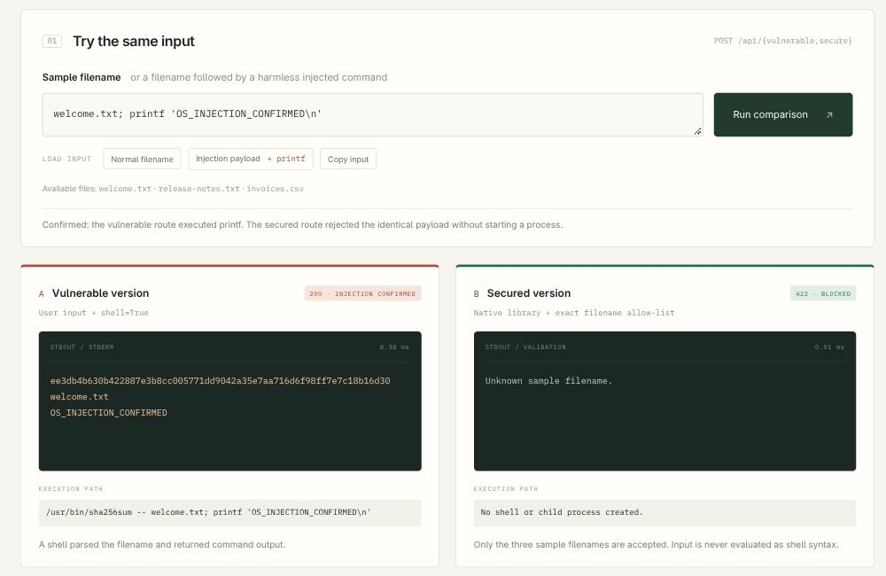

# C. OS Command Injection

Member: Manas Singh | Roll number: IIB2024014
Category: OS command injection | Implemented variant: In-band (command output returned)

## 1. Overview and Root Cause

OS command injection occurs when untrusted input changes a command executed by a server's operating system. In this project, a field intended to contain a sample filename can introduce an additional shell command. This crosses the boundary between data and executable instructions.

The potential impact depends on the server process's permissions: an injected command could read or modify accessible files, disrupt the service, or perform other unauthorised actions. The demonstration uses only a harmless fixed marker and synthetic sample files in our own local container.

## 2. Variant Implemented: In-band Command Injection

In-band injection returns the injected command's output in the same HTTP response. Here, the server captures standard output and the browser displays the result. Blind command injection, by comparison, infers execution from timing or another side effect when direct output is unavailable. Only the in-band variant is implemented for this member's contribution.

## 3. Practical Implementation: Checksum Lab

The website computes the SHA-256 checksum of a sample file. A checksum is a fingerprint of file contents, not encryption. The interface sends identical input to two endpoints so that the intended behavior, exploit, and secured behavior can be compared directly.

### (a) Vulnerable Implementation

Code path: POST /api/vulnerable -> Handler.do_POST() -> run_checksum() -> vulnerable_checksum() in app/server.py.

The vulnerable sink concatenates the user-controlled filename into a command string and asks a shell to interpret it. Relevant excerpt:

```python
command = f"{SHA256SUM} -- {filename}"
process = subprocess.Popen(
    command,
    shell=True,
    cwd=SAMPLES,
    stdout=subprocess.PIPE,
    stderr=subprocess.PIPE,
    text=True,
    # remaining process options omitted
)
stdout, stderr = process.communicate(timeout=2)
```

The handler returns the captured output in JSON. For normal input, welcome.txt, the command is /usr/bin/sha256sum -- welcome.txt, and both implementations return the same checksum.

### (b) Working Exploit and Exact Payload

Use this exact filename-field value:

```text
welcome.txt; printf 'OS_INJECTION_CONFIRMED\n'
```

The shell interprets the resulting command as:

```sh
/usr/bin/sha256sum -- welcome.txt; printf 'OS_INJECTION_CONFIRMED\n'
```

The semicolon separates two commands. The first computes the checksum; the second prints the fixed marker. The backslash-n tells printf to end the output with a newline. Clicking Injection payload and then Run comparison executes the request against our local lab.

Observed vulnerable result: HTTP 200, followed by the normal checksum and a separate line containing OS_INJECTION_CONFIRMED. Seeing this line in the returned output proves execution of the additional command. This is in-band because the output returns in the same web response; response timing is not used as the evidence.

The exact JSON body is also supplied in evidence/payload.json. Complete requests and responses are recorded in evidence/requests.json and evidence/transcript.txt.

### (c) Root Cause

Untrusted filename input is concatenated into a command evaluated with shell=True. The shell recognises the semicolon as a command separator, allowing a filename to introduce a second instruction. The utility's double hyphen ends option parsing but does not disable the shell's grammar.

### (d) Mitigation Implemented: Avoid Shell Execution

The primary mitigation replaces the OS command with Python's native hashlib library. The secure function does not create a child process or invoke a shell. It also applies an exact server-side allow-list of the three intended sample filenames to restrict file access.

Code path: POST /api/secure -> run_checksum() -> secure_checksum() in app/server.py. Excerpt, with response dictionaries shortened:

```python
ALLOWED_FILES = (
    "welcome.txt", "release-notes.txt", "invoices.csv"
)
if filename not in ALLOWED_FILES:
    return blocked_response
digest = hashlib.sha256(
    (SAMPLES / filename).read_bytes()
).hexdigest()
```

The identical payload returns HTTP 422, status blocked, an empty stdout field, and the message Unknown sample filename. The allow-list rejects this input; using hashlib removes the shell execution path itself. HTTP 422 reports the rejection and is not the mitigation by itself.

Valid filenames still return the expected checksum. Regression tests also replace subprocess.Popen with a failure stub and verify that both valid secure input and the exploit input never start a process.

## 4. Other Mitigation Techniques: Theory

Avoid the shell or OS command: Prefer a native library or API when it provides the required operation. This is the selected primary fix: hashlib calculates the checksum directly without an interpreter.

Parameterised execution with an argument vector: If an external program is necessary, pass a fixed executable and separate arguments with shell=False, for example subprocess.run(["/usr/bin/sha256sum", "--", validated_filename], shell=False, ...). Shell separators then remain argument data. Validate the arguments and prevent dangerous options, arbitrary executable selection, and unauthorised paths.

Allow-list validation: Accept only a narrow set of expected values on the server. This project also implements an exact set of sample filenames. Client-side checks are bypassable, and rejecting only a few shell symbols is an incomplete blacklist.

Least privilege: Run the application under a restricted account with minimal filesystem and network access. This limits the consequences of exploitation but does not repair unsafe command construction. The provided container runs as a non-root user with a read-only root filesystem and dropped capabilities; its normal bridge network still permits outbound traffic.

## 5. Verification and Evidence

The three comparison cases were verified:
- Normal filename: both endpoints return HTTP 200 and the same SHA-256 checksum.
- Exact payload through the vulnerable endpoint: HTTP 200 and OS_INJECTION_CONFIRMED in stdout.
- Identical payload through the secured endpoint: HTTP 422, blocked, and no command output.

All 13 functional and security regression tests passed. They cover matching sample checksums, actual exploitation, the identical blocked payload, absence of process creation in the secured route, alternative shell syntax and invalid paths, invalid input types, a command timeout, and HTTP protections. The evidence verifier also passed all seven comparisons across four real HTTP requests.

The repository includes the full baseline screenshot, the exploit-and-mitigation screenshot, the raw HTTP evidence, and the test log. The figure below shows the actual same-input comparison: the left route executes the harmless printf command, while the right route rejects the identical payload.



Figure C1. Local browser evidence for the in-band exploit and implemented mitigation.

## 6. Running the Website

With Docker Engine/Desktop and Compose available, run these commands from the group repository root:

```bash
cd IIB2024014/os-injection-lab
docker compose up --build -d --wait
```

Open http://127.0.0.1:8080. First run Normal filename, then Injection payload. Keep the application bound to localhost because it deliberately contains a vulnerable endpoint. Stop it afterwards with docker compose down.

## 7. Source Code and References

[Group repository](https://github.com/devanshrai23/CS_Lab4_Assignment)
[OS command injection contribution](https://github.com/devanshrai23/CS_Lab4_Assignment/tree/main/IIB2024014)
[OWASP OS Command Injection Defense Cheat Sheet](https://cheatsheetseries.owasp.org/cheatsheets/OS_Command_Injection_Defense_Cheat_Sheet.html)
[Python subprocess security considerations](https://docs.python.org/3/library/subprocess.html#security-considerations)
[MITRE CWE-78: OS Command Injection](https://cwe.mitre.org/data/definitions/78.html)
