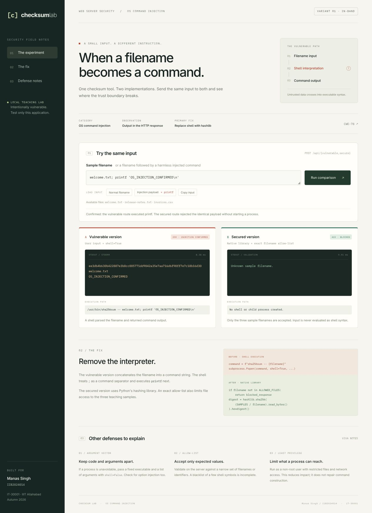

# Checksum Lab - OS Command Injection

A working **in-band OS command injection** lab for IT-30001, Web Server Security, IIIT Allahabad (Autumn 2026). A sample-file checksum tool has a vulnerable implementation and a secured implementation. The same HTTP input is sent to both, so the exploit and fix can be demonstrated together.

## Ownership declaration

| Member name | Roll number | Category | Variant implemented |
|---|---|---|---|
| Manas Singh | IIB2024014 | OS command injection | Variant 1: in-band (command output returned) |

This is the OS command injection portion of the group assignment. Add the other members and their separate categories to your group's final repository. Review and adapt this prepared implementation under your course's originality and AI-assistance rules, and be ready to explain the code yourself.

## Run

Install Docker Engine/Desktop with the Compose plugin. From this directory:

```bash
docker compose up --build -d --wait
```

Open **http://127.0.0.1:8080**. The first build downloads the pinned official Python image; the application has no third-party Python dependencies. Docker provides a consistent Linux shell on Linux, macOS and Windows.

Stop when finished:

```bash
docker compose down
```

The vulnerable route deliberately executes OS commands. Run only as this local teaching container. Port 8080 is published on `127.0.0.1` only; do not deploy this application on a public host or change the bind address to `0.0.0.0`. Do not mount your home directory, credentials, or the Docker socket into it.

The container uses UID/GID 10001, a read-only root filesystem, dropped capabilities, no new privileges, and limits on memory, processes and CPU. It uses Docker's ordinary bridge network, which permits outbound traffic; it is not an offline sandbox or a complete security boundary. The application refuses its normal startup outside Docker or as root. These safeguards reduce the lab's risk; they do not fix the intentionally vulnerable endpoint.

If port 8080 is occupied, change only the host side of `127.0.0.1:8080:8080` in `compose.yaml`, for example to `127.0.0.1:8081:8080`, and open the corresponding address. Pass the same base URL to the evidence script.

## Three-step demonstration

1. Leave `welcome.txt` in the input and click **Run comparison**. Both versions return the same SHA-256 digest.
2. Click **Injection payload**, then **Run comparison**. The vulnerable response includes `OS_INJECTION_CONFIRMED` after the checksum. This is real output from the injected shell `printf`, not a frontend simulation.
3. Point to the secured response for that identical input: HTTP **422**, `blocked`, empty standard output, and no child process. Then explain the changed code.

The exact payload is:

```text
welcome.txt; printf 'OS_INJECTION_CONFIRMED\n'
```

The marker is harmless: it prints a fixed line, without reading private data, changing files, or contacting another system. Use it only against your own lab.




## Assignment requirements mapped to the project

| Requirement | Implementation / evidence |
|---|---|
| (a) Vulnerable implementation | `app/server.py` -> `vulnerable_checksum()`, marked `VULNERABLE SINK` |
| (b) Exact working exploit | Payload above; `evidence/payload.json`, `requests.json`, `transcript.txt`, screenshots |
| (c) Root cause | User input is concatenated into a string evaluated by `/bin/sh` using `shell=True`; `;` begins a second command. |
| (d) Implemented mitigation | `secure_checksum()` uses `hashlib.sha256` instead of an OS command; an exact filename allow-list also restricts file access. The same payload returns HTTP 422. |
| (e) Other mitigations, theory | The section below, the application's defense notes, and `OS-Command-Injection-Report.pdf` |
| Repository source and ownership | Source tree and ownership table in this README |
| Video and viva preparation | Timed narration and viva questions in the report; record your own 2-3 minute portion |

## Root cause and implemented fix

The vulnerable path is intentionally equivalent to:

```python
command = f"{SHA256SUM} -- {filename}"
subprocess.Popen(command, shell=True, ...)
```

For the payload, the shell executes:

```sh
/usr/bin/sha256sum -- welcome.txt; printf 'OS_INJECTION_CONFIRMED\n'
```

`--` ends the utility's option parsing. **It does not stop the shell interpreting `;`**. The first command computes the expected checksum, then the second prints a marker. Its output is captured and returned in the same HTTP response, making this an **in-band** variant.

The primary mitigation removes shell execution entirely:

```python
if filename not in ALLOWED_FILES:
    return blocked_response
digest = hashlib.sha256((SAMPLES / filename).read_bytes()).hexdigest()
```

The actual complete response dictionaries are in `secure_checksum()`. `hashlib` computes the hash directly in Python, so no interpreter receives the input. The exact filename allow-list is an additional implemented control against path traversal and arbitrary file reads. Blocking a particular payload alone is not the proof of the primary fix: tests also verify that both valid and invalid secure requests never call `subprocess.Popen`.

## Other mitigations to explain at the viva

- **Avoid the shell / OS command:** use a native API when available, as this project does with `hashlib`. This removes the command interpretation boundary.
- **Parameterised execution with an argument vector:** if an external program is required, pass a fixed executable and separate arguments, for example `subprocess.run(["/usr/bin/sha256sum", "--", validated_filename], shell=False, ...)`. This keeps shell syntax as literal data. Still validate paths, prevent executable selection, and consider option injection; `shell=False` alone does not make every program invocation safe.
- **Allow-list validation:** check server-side that input belongs to the narrow expected set, as this project also does. It rejects extra syntax and invalid paths. Client-side checks are bypassable, and a blacklist of a few separators is incomplete.
- **Least privilege:** use a restricted non-root account with minimal filesystem and network access. This limits the damage of exploitation; it does not remove the injection bug. Docker's controls in this project are supporting measures, not the primary code fix.

Shell-specific quoting can protect individual arguments in some designs, but it is easy to apply in the wrong context and does not resolve every argument/option abuse. Prefer removing the shell, and use a fixed executable plus validated arguments when execution is necessary.

## Reproduce HTTP evidence

With the lab running, use Python 3.10+ on the host (no pip install required):

```bash
python3 scripts/verify.py
```

This makes four real requests (normal/vulnerable, normal/secure, payload/vulnerable, payload/secure), verifies seven comparisons, and writes `evidence/requests.json` and `evidence/transcript.txt`. The JSON includes timestamps and SHA-256 hashes of the relevant source files. Only this lab's localhost address is accepted by the script.

You can also use curl from this project directory:

```bash
curl -i http://127.0.0.1:8080/api/vulnerable \
  -H 'Content-Type: application/json' -H 'X-Lab-Request: 1' \
  --data-binary @evidence/payload.json

curl -i http://127.0.0.1:8080/api/secure \
  -H 'Content-Type: application/json' -H 'X-Lab-Request: 1' \
  --data-binary @evidence/payload.json
```

The application requires the custom header and JSON content type, rejects cross-origin requests and unrecognised Host values, and uses no CORS exceptions. These controls reduce the chance of another website driving the local vulnerable route; they are not command injection mitigations.

## Run the tests

```bash
docker compose run --rm --no-deps lab python -m unittest discover -s tests -v
```

The 13 regression tests cover matching checksums for all three samples, actual shell exploitation, the identical blocked payload, no process creation by the fixed route, alternative metacharacters, invalid paths and input types, a command timeout, real HTTP behavior, origin/Host protections, and static-file restrictions. The group repository's root workflow, `.github/workflows/os-command-injection.yml`, builds this project and runs the suite with networking disabled. Local results are in `evidence/tests.txt`.

## Source layout

```text
app/server.py                  HTTP routes, intentionally vulnerable sink, implemented fix
app/static/                    Self-contained browser interface; no CDN or build step
app/samples/                   Three synthetic files
tests/test_lab.py              Security and functional regression tests
scripts/verify.py              Reproducible HTTP evidence capture
compose.yaml / Dockerfile      Local container runtime
evidence/                      Actual requests, output, screenshots, test results
OS-Command-Injection-Report.pdf Explanation, evidence, narration script, viva preparation
../../.github/workflows/os-command-injection.yml  Container-based CI
```

## Finish the submission

1. Review the implementation and ensure it meets the course's originality/AI-assistance policy. The provided lecture slides were not included, so compare the alternative-mitigation explanations with your slides.
2. Integrate the other members' separate categories if applicable and complete the group's ownership table.
3. Ensure this contribution is merged into the public group repository at https://github.com/devanshrai23/CS_Lab4_Assignment, including its evidence files.
4. Record your own narrated 2-3 minute screen demonstration. The report gives a timed outline; the screenshots are evidence, not a substitute for the required video.
5. Submit the repository link and video/link as instructed by your course page, and rehearse the live demonstration.

The supplied assignment states a deadline of **27 October 2026, 23:59**. Verify the course page for any revision and the applicable submission timezone.

## References

- [OWASP: OS Command Injection Defense Cheat Sheet](https://cheatsheetseries.owasp.org/cheatsheets/OS_Command_Injection_Defense_Cheat_Sheet.html)
- [Python: subprocess security considerations](https://docs.python.org/3/library/subprocess.html#security-considerations)
- [MITRE: CWE-78](https://cwe.mitre.org/data/definitions/78.html)

Source assignment: `Assignment_Web_Server_Security.docx.pdf`, supplied by the student. The assignment and lecture slides are not redistributed in this repository.
